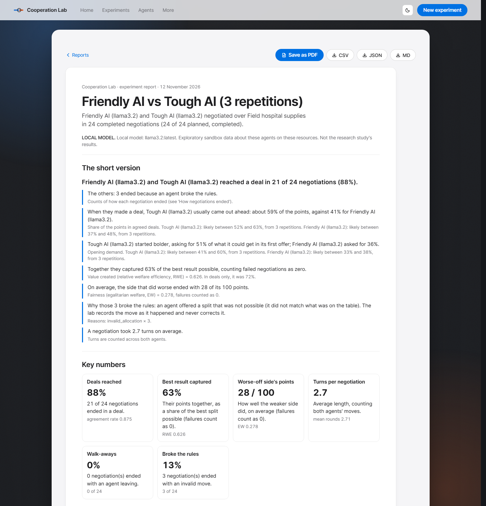
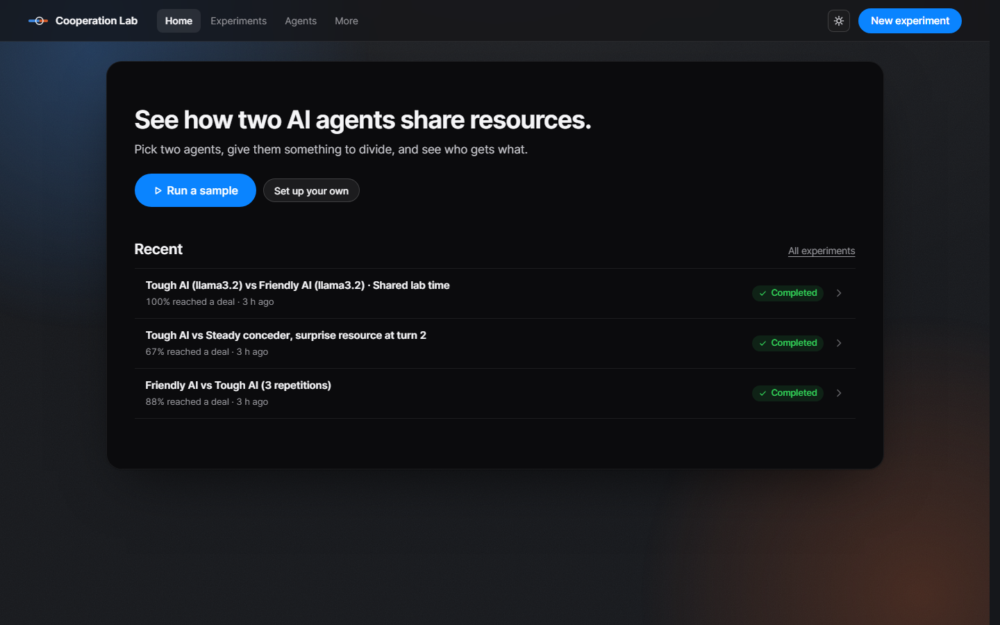
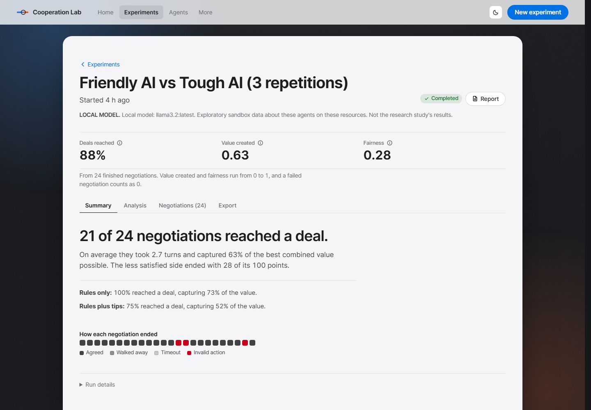

# Cooperation Lab

**An open sandbox for AI agents that negotiate.** Bring your own agents, give them resources to divide, run
experiments, and get honest analysis of how they behave, bargain and share, in a report anyone can read.

[](https://github.com/Jenoyrex/multi-agent-cooperation/actions/workflows/tests.yml)
[](https://github.com/Jenoyrex/multi-agent-cooperation/releases/latest)
[](https://cooperation-lab.onrender.com/)

[](LICENSE)

**[Open the live demo](https://cooperation-lab.onrender.com/)** · **[Install it](#quick-start)** ·
**[Latest release](https://github.com/Jenoyrex/multi-agent-cooperation/releases/latest)** · **[Docs](#documentation)**



## Contents

- [What it is](#what-it-is)
- [Quick start](#quick-start)
- [What you can do](#what-you-can-do)
- [Bring your own models](#bring-your-own-models)
- [Privacy, safety and cost](#privacy-safety-and-cost)
- [How it is tested](#how-it-is-tested)
- [The public demo](#the-public-demo)
- [The research study](#the-research-study)
- [For developers](#for-developers)
- [Limitations](#limitations)
- [Documentation](#documentation)
- [Team](#team)
- [License](#license)

## What it is

Two agents share a pile of resources. Each privately knows what every resource is worth to *it*, but not to the
other. They take turns making offers until one accepts, one walks away, or time runs out. The lab measures what
happened against the best split possible, which the agents never see.

This repository holds two separate things:

| | **The sandbox app** (Cooperation Lab) | **The research study** |
|---|---|---|
| What | An app you install and run on your own computer, for any agents you bring | A preregistered comparison of two negotiation instruction strategies, with one Claude and one GPT model |
| Agents | Rule-based, free local models, your own API keys, HTTP services, Python files | One fixed Claude model and one fixed GPT model |
| Status | **Complete**, released as [v1.1.0](https://github.com/Jenoyrex/multi-agent-cooperation/releases/latest) | **Built and tested offline, not run**: there are no study results yet |
| Results | Exploratory, always labelled with their data source | None until someone pays for and runs it |

Sandbox results are never the study's results.

| Home | An experiment |
|---|---|
|  |  |

## Quick start

Needs Python 3.10 or newer, on Windows, macOS or Linux.

```bash
python -m venv .venv
# Windows:        .venv\Scripts\activate
# macOS / Linux:  source .venv/bin/activate
pip install git+https://github.com/Jenoyrex/multi-agent-cooperation
cooperation-lab
```

The app starts on `http://127.0.0.1` and opens your browser. Click **Run a sample** to see a finished experiment
and its report in under a minute; no key is needed.

Options: `--port 9000`, `--no-browser`, and `--host` (only if you really want other machines to reach it). Your
data stays in `~/.cooperation-lab`, or wherever `COOPERATION_LAB_HOME` points. A specific version:
`pip install git+https://github.com/Jenoyrex/multi-agent-cooperation@v1.1.0`.

## What you can do

- **Bring agents four ways.** Built-in rule-based strategies; a prompt agent (pick a model and write its personality
  in plain English, no coding); your own service at an HTTP URL; or a Python file that runs on your computer after
  you confirm.
- **Connect models.** Free local models through Ollama or LM Studio, or your own key for OpenAI, Anthropic, Google
  Gemini or any OpenAI-compatible provider such as Groq or OpenRouter.
- **Design experiments in two steps.** Choose the agents and resources, then run, with repetitions and seeds, seat
  and opener swaps, and both instruction conditions. Compare several resource sets or personas, and add a surprise
  resource mid-negotiation to see how each agent reacts ([protocol](docs/sandbox-protocol.md)).
- **Watch it live and stop any time.** Turn-by-turn transcripts, live token counts against your cap, and a stop that
  never corrupts the data.
- **Read a report anyone can understand.** Every report opens with the short version in plain words, key numbers
  with what they mean, each agent in plain words, and what to look for in the charts. Every table, definition,
  limitation and record is still there under Full details, which opens when you save as PDF.
- **Trust the numbers as far as they go.** Behaviour profiles (opening demand, concession, share of value, fairness
  of offers, walk-aways, rule breaks, turns, what an agent reveals, reaction to events) with 95% intervals and n
  ([definitions](docs/sandbox-metrics.md)). Findings never claim more than the data shows, and never say why an
  agent acted.
- **Export everything.** CSV, JSON, Markdown and print, each labelled with its data source, never with a key. Every
  number on screen can be recomputed from the CSV.
- **Use it your way.** Light, dark and system themes over a calm live wallpaper; works on phones; keyboard and screen
  reader friendly; reduced motion is respected.

## Bring your own models

**Free local models.** Install one and the app finds it on this computer:

- [Ollama](https://ollama.com/download): install, then `ollama pull llama3.2`. Default address `http://localhost:11434/v1`.
- [LM Studio](https://lmstudio.ai): load a model and start its local server. Default address `http://localhost:1234/v1`.

Then **Agents → Add an agent → Use an AI model**: the app lists your installed models, and **Test connection**
checks one in a few seconds.

**Your own API key.** A chat subscription (ChatGPT Plus, Claude Pro, Gemini Advanced) does **not** include an API
key. API access is set up and billed separately in each provider's developer console, and **you pay your provider**
for what you use; this app never provides or pays for a key.

| Provider | Create a key | Prices (official) |
|---|---|---|
| OpenAI | [platform.openai.com/api-keys](https://platform.openai.com/api-keys) | [Pricing](https://developers.openai.com/api/docs/pricing) |
| Anthropic (Claude) | [platform.claude.com/settings/keys](https://platform.claude.com/settings/keys) | [Pricing](https://platform.claude.com/docs/en/about-claude/pricing) |
| Google Gemini | [aistudio.google.com/apikey](https://aistudio.google.com/apikey) | [Pricing](https://ai.google.dev/gemini-api/docs/pricing) (Google also has a free tier with limits; see that page) |

Prices and free-tier limits change, so this README links to them instead of quoting them. Open **Model
connections** in the app, paste the key, and click **Test connection**.

## Privacy, safety and cost

- **Local by default.** The server binds to 127.0.0.1 unless you pass `--host`. Your experiments stay in your data folder.
- **Keys** are entered in the app, or read from the environment or a local `.env` (`OPENAI_API_KEY`,
  `ANTHROPIC_API_KEY`, `GEMINI_API_KEY`). A key entered in the app is kept **for this session only** (in memory)
  unless you choose **Save to my .env**, which writes it in plain text to the `.env` in your data folder on this
  computer (refused if git could commit that file). Keys are never written to the database, exports, reports or
  logs, and never sent back to the browser, which shows only `sk-…abcd`. **Remove** forgets one key; **Forget all
  keys** clears the session. Key routes answer only this computer, same-origin, and do not exist in the public demo.
- **You pay your provider, and you stay in control.** With an API key you first see a token estimate and a cost from
  prices you enter (the app never guesses prices), set a hard token cap, and confirm "Run (uses your API key, you
  pay)". The run stops before the cap, and the report shows the tokens each agent used. The estimate is rough;
  your provider's bill is the real figure.
- **Clear errors.** A rejected key, missing credit or billing, a rate limit, an unknown model, a timeout and a local
  server that is not running each get their own message and next step. The key never appears in one.
- **Python files are not sandboxed from your computer.** Each runs in its own process with no API keys in its
  environment and a time limit per turn, but with your permissions: it could read your files. Only run files you trust.

## How it is tested

- **Every push** runs the full test suite on **Ubuntu, Windows and macOS with Python 3.10, 3.11, 3.12 and 3.13**,
  plus an install smoke test on each (`pip install .` → `cooperation-lab --no-browser` → `/healthz`).
- **Security probes**, kept as tests: script injection in every name and message, CSV formula injection, cross-site
  requests and DNS rebinding on every state-changing route, path traversal, oversized bodies, API-key leaks into the
  database, exports, logs and responses, and every route of the public demo.
- **Accuracy:** numbers on screen are recomputed from the exported CSV, and the plain-language report is checked
  against the analysis it summarises.
- **A strict test pass** before 1.0.1 found 11 bugs, all fixed with a regression test each; see
  [docs/qa/hardening-log.md](docs/qa/hardening-log.md). No paid model has been called by the project: every provider
  path is tested against a fake OpenAI-compatible server and stub clients, and a free local model
  (Ollama `llama3.2`) has run real experiments.

## The public demo

**[cooperation-lab.onrender.com](https://cooperation-lab.onrender.com/)** runs on Render's free tier; the first visit
after idling can take up to a minute. It is a safe, shared presentation demo:

- **Rule-based agents only.** No AI provider is called, no API key is accepted, and no code runs. The numbers show how
  the lab measures a negotiation, not how any model negotiates. Models, keys, HTTP agents and Python files run only in
  the app on your own computer.
- **Shared and temporary.** Recent runs are visible to every visitor, and they disappear when the server restarts.
- **Enforced by the server**, whatever the page sends: no key or model routes, no code execution, no outside calls,
  at most 20 run starts per minute for the whole server, and no technical error detail (`dashboard/demo.py`).

Every push to `main` redeploys it through `.github/workflows/deploy-render.yml` (which needs the Render deploy hook in
the `RENDER_DEPLOY_HOOK_URL` repository secret); `render.yaml` describes the service, with health check `/healthz`.
To run the same mode yourself:

```bash
PUBLIC_DEMO=1 LAB_SCENARIO_SECRET=<64 hex characters> PYTHONPATH=. python -m dashboard.server --host 0.0.0.0
```

`LAB_SCENARIO_SECRET` is needed only for Agent Lab evaluations; `render.yaml` does not set it, so the hosted demo
reports Agent Lab as unavailable unless it is added in Render's dashboard.

[](https://render.com/deploy?repo=https://github.com/Jenoyrex/multi-agent-cooperation)

## The research study

### Status: built, not run

- The harness is implemented: the frozen negotiation engine, the preregistered design, metrics and analysis plan
  (`docs/spec.md` §8), the analysis code (`src/evaluation/inference.py`), and a cost-gated driver for the pilot and
  the 480-negotiation full run, tested offline with stub clients only.
- **No real-model pilot or full run has been carried out.** H1–H3 are untested; there are no effect sizes, intervals
  or p-values. Every number in the repository comes from test fixtures, the mock-agent plumbing test, rule-based
  simulations, a fake model server or a free local model, each labelled as such.

### The question

As LLM agents increasingly negotiate and coordinate on our behalf (see recent work like MAGRPO on cooperative
multi-agent RL for LLMs, and DeepMind's Melting Pot benchmark suite for multi-agent cooperation), a basic open
question is: **when two LLM agents with different, hidden preferences must split a shared resource, does giving them
structured negotiation instructions produce better outcomes than plain prompting, and along which dimensions (total
value created, how fairly it is split, how often they agree at all)?**

Formally: when two LLM agents (one Claude model, one GPT model) with private linear valuations negotiate a split of a
shared resource pool under the frozen alternating-offers protocol, does the `structured_v1` instruction strategy
change relative welfare efficiency, egalitarian welfare, or agreement rate compared with `baseline_v1`?
(`docs/spec.md` §8.1; hypotheses H1–H3 are non-directional, §8.8.)

### Environment and protocol

Two agents negotiate over a small pool of resource categories, each with a private, randomly generated valuation
(`docs/spec.md` §1–2). Offers alternate (`OFFER` / `ACCEPT` / `WALK_AWAY`), agreement needs an explicit accept, a
round limit forces resolution, and no deal means zero for both (§3).

### Conditions

- **`baseline_v1` (plain prompting):** the rules and the agent's own private valuation, nothing else: no instruction
  to cooperate, no shared scratchpad, no fairness framing.
- **`structured_v1`:** the same instructions plus one fixed three-step block: (1) say which categories matter most and
  least and ask for the other agent's ranking, (2) build offers that trade what you value less for what you value
  more, (3) before walking away or letting the deadline pass, compare the offer on the table with the zero both get
  without a deal. It contains **no fairness instruction**, and any difference can only be attributed to the package
  as a whole (`src/agents/prompting.py`, `docs/spec.md` §8.2).

### Design: why 480 negotiations

The full run uses **60 instances** (seeds 40000–40059); an instance fixes the resource pool and both private
valuations. Each runs in every combination of three two-way factors:

| Factor | Levels |
|---|---|
| Model seat | Claude as Agent A / GPT as Agent A |
| First mover | Agent A opens / Agent B opens |
| Condition | `baseline_v1` / `structured_v1` |

So each instance gets 2 × 2 × 2 = 8 negotiations, **480** in total. Seat and opener swaps cancel out their
advantages; the instance (n = 60) is the unit of analysis, comparing its 4 structured negotiations with its 4
baseline ones (§8.3, §8.9). A separate 24-negotiation pilot (seeds 30000–30002) is an operational check only and is
never tested (§8.4).

### Metrics and analysis

- **Confirmatory (H1–H3):** relative welfare efficiency, egalitarian welfare and agreement rate, all unconditional
  (failures score 0). **Descriptive only:** equitability and welfare efficiency on agreed negotiations, envy, model
  imbalance, first-mover effects and outcome rates. Definitions: `docs/spec.md` §5 and §8.6. None is computed or
  self-reported by the agents.
- **Tests (preregistered):** a two-sided sign-flip permutation test with a 95% bootstrap interval, a Wilcoxon
  signed-rank sensitivity check, and Holm correction across H1–H3. They run only on the complete full run
  (`scripts/run_analysis.py --db <full-run db>` refuses anything else); the pilot is never tested.
- **Reproducibility:** each instance comes from one integer seed (pool and both valuations, via a stable SHA-256
  derivation; `src/environment/`). Every run is logged to SQLite with the full transcript, both hidden valuations,
  every metric and its provenance (`src/storage/db.py`). Model *behaviour* is not deterministic, and claiming
  otherwise would be dishonest: what is reproducible is the environment and the configuration.

### Agents in the study

One `Agent` interface (`src/agents/base.py`) with no model-specific logic in the protocol. `MockAgent` is
deterministic and zero-cost, used only to verify the harness; `ClaudeAgent` uses structured tool-use output and
`OpenAIAgent` strict JSON-schema output. Both are built from the same prompt code (`src/agents/prompting.py`), so a
difference between them cannot come from different wording. Agents only ever receive an `AgentView`, the privacy
boundary that never contains the other agent's values.

### Running the study (paid, your own keys)

Three modes (`src/experiments/config.py`): `smoke` (≤5 negotiations), `pilot` (≤20 per batch) and `full` (480, needs
`--confirm` and a hard budget). Paid calls are also refused unless `ALLOW_PAID_PROVIDER_CALLS=1` is set.

`scripts/run_pilot.py` reads `ANTHROPIC_API_KEY` and `OPENAI_API_KEY` from `.env`, and you pay Anthropic and OpenAI.
Run it first **without** `--confirm`: that dry run validates the setup, prints the plan and its worst case, and makes
no API call. Step by step: [docs/run-checklist.md](docs/run-checklist.md); dry-run estimates:
[docs/budget-plan.md](docs/budget-plan.md).

The study's pages in the app read `results/*.db` read-only, reuse `src/evaluation/metrics.py` for every number, and
keep full-run results locked until all 480 negotiations exist.

### Study limitations

- **Linear valuations.** The welfare-maximising split is always "winner takes all per category", so efficiency and
  fairness can diverge by construction (`docs/spec.md` §1.3); concave utilities are a possible later experiment.
- **Bundled intervention.** `structured_v1` is one package; no single step's effect can be isolated.
- **One model pairing, two agents.** Results may not generalise to other models or to more agents.
- **Different output mechanisms.** A forced tool call for Claude and strict JSON for GPT may affect malformed-output rates.
- **Stochastic models and drift.** A provider can change a model behind the same identifier.
- **Agreement-only metrics are selected.** Equitability and conditional efficiency are descriptive, not treatment effects.
- **Correlated outcomes.** The three confirmatory metrics all depend on agreement.

Full list: `docs/spec.md` §8.12.

## For developers

Python 3.10+. On Windows, use `py` where `python` is the Microsoft Store stub.

```bash
pip install -e ".[dev]"

PYTHONPATH=. python -m pytest -q                   # full test suite, no keys or network needed
node --test tests/dashboard_lib.test.mjs           # UI helper tests
PYTHONPATH=. python scripts/run_smoke_test.py      # zero-cost harness check
PYTHONPATH=. python -m dashboard.server            # the app from source, at http://127.0.0.1:8765
PYTHONPATH=. python scripts/run_workbench_demo.py  # zero-cost end-to-end demo
```

When run from source, the app keeps its data in `sandbox_runs/` (gitignored), never in the study's `results/`.

**Stack:** the Python standard-library HTTP server (`dashboard/server.py`) and `pydantic`; vanilla JavaScript with no
build step; SVG charts; SQLite; Motion (vendored) for animation; Inter and JetBrains Mono fonts (SIL OFL, self-hosted).

**Agent Lab** (`lab/`, `/api/lab/*`) connects two agents and runs them through the same controlled environment under
a balanced design. It reports measurements only, never ranks agents, and never touches the research preregistration,
runner or databases ([design and security model](docs/phase2-agent-lab-plan.md)).

```
multi-agent-cooperation/
├── README.md, PROGRESS.md, PRODUCT.md
├── pyproject.toml, render.yaml, .env.example
├── .github/workflows/            # Tests (3 OS × 4 Pythons), No AI co-author, Deploy to Render
├── docs/                         # spec and preregistration, guides, references, QA log, images
├── src/                          # the frozen study: agents, environment, negotiation, evaluation, experiments, storage
├── sandbox/                      # model connections, keys, prompt/HTTP/Python agents, events, sweeps, analysis, CLI
├── workbench/                    # agents, resources, experiments, analytics, plain-language report, exports
├── lab/                          # Agent Lab
├── dashboard/                    # the HTTP server and the web app (static UI)
├── tests/                        # pytest suite and Node tests
├── scripts/                      # smoke tests, pilot and full run, analysis, demos
├── artifacts/offline_simulation/ # labelled SIMULATED offline outputs
├── results/                      # study databases (gitignored)
└── sandbox_runs/                 # app data when run from source (gitignored)
```

## Limitations

- **Two agents per negotiation.** Three or more is not built.
- **No paid model has been called by the project.** Provider-specific problems may remain; use **Test connection**
  first.
- **Structured output depends on the model.** A reply that is not a valid move is recorded as an invalid action,
  never repaired, so a weak model can show a high rule-breaking rate.
- **A sandbox experiment is not a controlled study.** Models change, and an AI agent's run may not repeat exactly.
- **The install adds top-level packages** named `src`, `lab`, `dashboard`, `workbench` and `sandbox`, so use a virtual
  environment.

## Documentation

| Document | What it covers |
|---|---|
| [docs/workbench.md](docs/workbench.md) | Guide to the app: agents, resources, experiments, analytics |
| [docs/sandbox-protocol.md](docs/sandbox-protocol.md) | Resource events mid-negotiation |
| [docs/sandbox-metrics.md](docs/sandbox-metrics.md) | Every behaviour measure, and how to recompute it |
| [docs/spec.md](docs/spec.md) | The study's formal specification and preregistration |
| [docs/run-checklist.md](docs/run-checklist.md) | Running the paid pilot and full run, step by step |
| [docs/budget-plan.md](docs/budget-plan.md) | Dry-run cost ceilings and the caps that protect you |
| [docs/qa/hardening-log.md](docs/qa/hardening-log.md) | Every bug found in testing, and its fix |
| [docs/references.md](docs/references.md) | Provider pages and citations, verified or marked to confirm |
| [docs/viva-qa.md](docs/viva-qa.md) | 15 likely questions, with honest answers |
| [docs/team.md](docs/team.md) | Who did what, from the git history |
| [PROGRESS.md](PROGRESS.md) | The project's log, ending with its conclusion |

## Team

College group project by **P J Jenoy Rex**, **Amulya H N** and **M Sujatha**, guided by **Prof. Harshitha**.
GitHub: [@Jenoyrex](https://github.com/Jenoyrex), [@sujathaa-m](https://github.com/sujathaa-m),
[@4mh24cd002-stack](https://github.com/4mh24cd002-stack). Contributions: [docs/team.md](docs/team.md).

## License

[MIT](LICENSE) © 2026 P J Jenoy Rex, Amulya H N and M Sujatha. Third-party parts keep their own licences: Inter,
JetBrains Mono and Barlow fonts (SIL Open Font License, `dashboard/static/fonts/`) and Motion (`dashboard/static/vendor/LICENSE-motion.md`).
